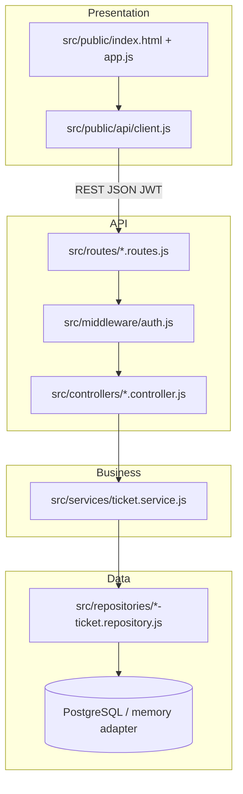
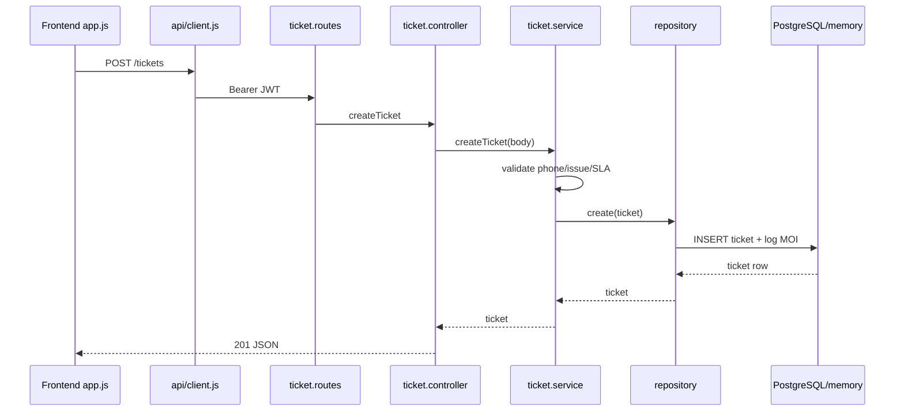

# Kiến trúc thực tế — Mekong Mobile Smart CRM (BT2)

**Luồng L2 · Track SE · MSSV 2374802011250**

Tài liệu này mô tả kiến trúc **đã hiện thực** trong repository (khác với sơ đồ thiết kế BT1 tại `docs/drawio/architecture.drawio`).

## 1. Tổng quan phân lớp

## 2. Luồng tạo phiếu (Sequence)

## 3. Thành phần chính

| Lớp | Trách nhiệm | File tiêu biểu |
|-----|-------------|----------------|
| Presentation | Màn hình, trạng thái loading/empty/error | `src/public/app.js`, `ui-state.js` |
| API client | Gom fetch, JWT, lỗi mạng | `src/public/api/client.js` |
| Routes | Endpoint + middleware auth/role | `src/routes/ticket.routes.js` |
| Controllers | HTTP status, JSON envelope | `src/controllers/ticket.controller.js` |
| Services | Quy tắc QT-01, QT-03, QT-04, SLA | `src/services/ticket.service.js` |
| Repositories | SQL / in-memory persistence | `postgres-ticket.repository.js` |
| Database | Schema + seed idempotent | `src/db/schema.sql`, `seed.sql` |

## 4. Cách mở sơ đồ nguồn

- Draw.io thiết kế BT1: `docs/drawio/architecture.drawio`
- Sơ đồ thực tế (Mermaid): file này — xem bằng VS Code/Cursor preview hoặc https://mermaid.live
- ERD: `docs/diagrams/erd-thuc-te.mmd` (sinh từ `schema.sql`)

## 5. Xuất PNG/PDF

1. Mở `docs/architecture-thuc-te.md` trong Cursor, preview Mermaid → chụp màn hình → lưu `docs/architecture-thuc-te.png`.
2. Hoặc dán khối Mermaid vào https://mermaid.live → Export PNG.

**Trạng thái:** Sơ đồ mã nguồn đã cập nhật; file PNG cần sinh viên export (xem `docs/screenshot-checklist.md` mục S11).
